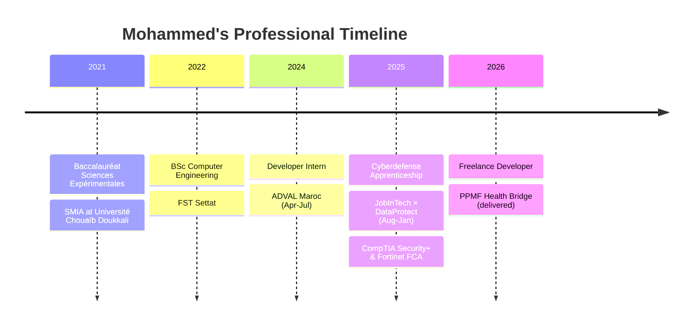
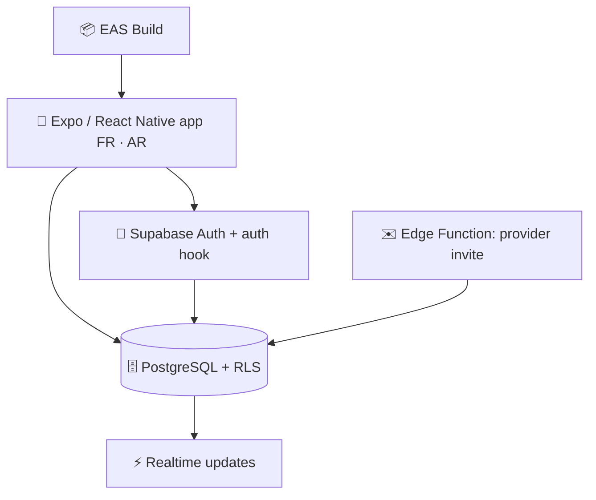
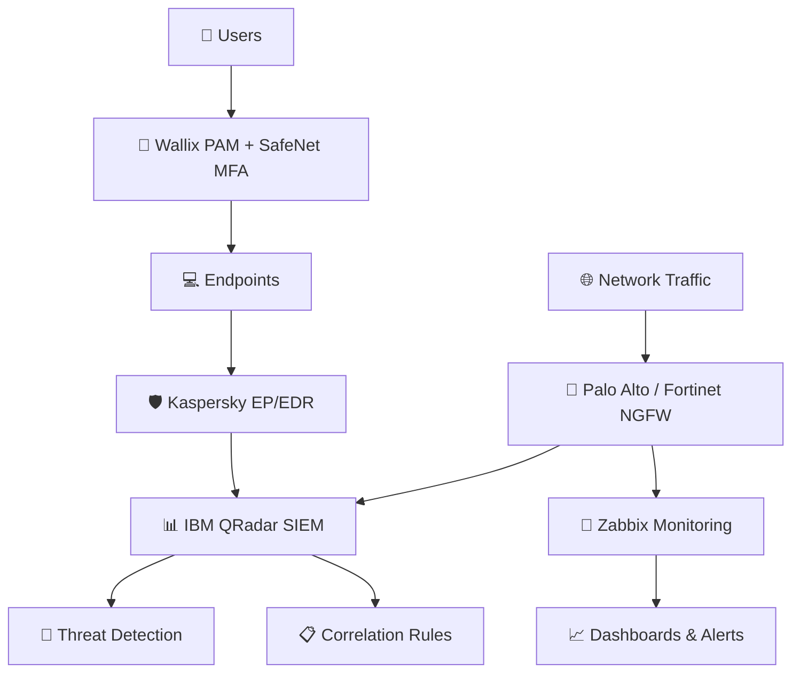
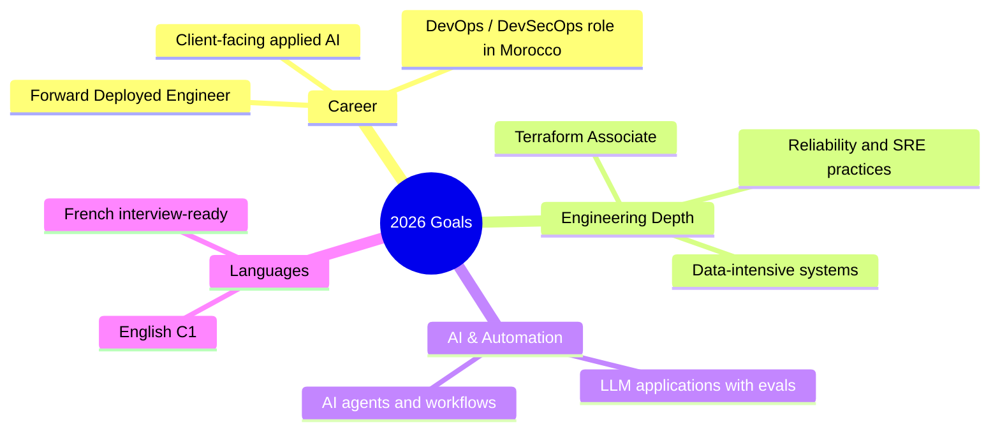

# Hi there, I'm Mohammed Abidou 👋

<div align="center">
  
</div>

<div align="center">
  
</div>

<br>

<div align="center">
  
  [](https://www.linkedin.com/in/mohammed-abidou-603284270)
  [](mailto:abidou.mohammed03@gmail.com)
  [](#)
  [](https://github.com/MohammedAbd01)
  
</div>

<div align="center">
  
  
  
  
</div>


## 🚀 About Me

<table>
<tr>
<td width="50%">

> **DevOps / DevSecOps & Backend developer** who deploys, secures and operates real applications end to end (Docker, PostgreSQL, nginx/Caddy, TLS). Backed by a 5-month cyberdefense apprenticeship at DataProtect (SIEM, EDR, PAM, firewalls) and a freelance healthcare app delivered from database schema to store submission.

- 🎓 **BSc Computer Engineering** — FST Settat (2022-2025)
- 🚀 **Freelance:** PPMF Health Bridge — mobile app + Supabase backend (delivered)
- 🛡️ **Apprenticeship:** Cyberdefense at JobInTech × DataProtect (5 months)
- 💼 **Previously:** Developer Intern at ADVAL Maroc (2 Django websites, WordPress support)
- 🔐 **Certified:** CompTIA Security+ · Fortinet FCA Cybersecurity
- 🎯 **Next:** Forward Deployed Engineer (applied AI), Morocco first
- 🌍 **Languages:** Arabic (Native) · French (Intermediate) · English (B2)

</td>
<td width="50%">

```python
class MohammedAbidou:
    def __init__(self):
        self.name = "Mohammed Abidou"
        self.role = "DevOps / DevSecOps / Backend"
        self.location = "Berrechid, Morocco 🇲🇦"
        self.languages = ["Python", "TypeScript", "JavaScript",
                          "PHP", "Java", "Bash"]
        self.infra = ["Docker", "PostgreSQL", "nginx / Caddy",
                      "Supabase"]
        self.security = ["IBM QRadar", "Palo Alto",
                         "Fortinet", "Kaspersky EDR"]
        self.certifications = [
            "CompTIA Security+",
            "Fortinet FCA Cybersecurity"
        ]
        self.next_step = "Forward Deployed Engineer"
    
    def say_hi(self):
        return "Let's build, deploy and secure something real! 🚀"
```

</td>
</tr>
</table>


## 🛡️ Certifications

<div align="center">

<table>
<tr>
<td align="center" width="300px">

<br><br>
<strong>CompTIA Security+</strong>
<br>
<sub>Threat Management · Risk Mitigation · Cryptography · Identity Management</sub>
</td>
<td align="center" width="300px">

<br><br>
<strong>Fortinet Certified Associate</strong>
<br>
<sub>Network Security · Firewall Configuration · Threat Landscape · FortiGate</sub>
</td>
</tr>
</table>

</div>


## 🛠️ Tech Arsenal

<div align="center">

### 💎 Programming Languages
<table>
<tr>
<td align="center" width="100px">

<br><strong>Python</strong>
</td>
<td align="center" width="100px">

<br><strong>TypeScript</strong>
</td>
<td align="center" width="100px">

<br><strong>JavaScript</strong>
</td>
<td align="center" width="100px">

<br><strong>PHP</strong>
</td>
<td align="center" width="100px">

<br><strong>Java</strong>
</td>
<td align="center" width="100px">

<br><strong>Bash</strong>
</td>
<td align="center" width="100px">

<br><strong>C</strong>
</td>
</tr>
</table>

### 🚢 DevOps &amp; Infrastructure
<table>
<tr>
<td align="center" width="100px">

<br><strong>Docker</strong>
<br><sub>Compose</sub>
</td>
<td align="center" width="100px">

<br><strong>Linux</strong>
<br><sub>Administration</sub>
</td>
<td align="center" width="100px">

<br><strong>nginx</strong>
<br><sub>Reverse proxy</sub>
</td>
<td align="center" width="100px">

<br><strong>Caddy</strong>
<br><sub>Reverse proxy / TLS</sub>
</td>
<td align="center" width="100px">

<br><strong>GitHub Actions</strong>
<br><sub>CI</sub>
</td>
</tr>
</table>

### 🛡️ Cybersecurity &amp; Monitoring
<table>
<tr>
<td align="center" width="120px">

<br><strong>IBM QRadar</strong>
<br><sub>SIEM</sub>
</td>
<td align="center" width="120px">

<br><strong>Zabbix</strong>
<br><sub>Monitoring</sub>
</td>
<td align="center" width="120px">

<br><strong>Palo Alto</strong>
<br><sub>NGFW</sub>
</td>
<td align="center" width="120px">

<br><strong>Fortinet</strong>
<br><sub>NGFW / VPN</sub>
</td>
<td align="center" width="120px">

<br><strong>Kaspersky</strong>
<br><sub>EP / EDR</sub>
</td>
</tr>
<tr>
<td align="center" width="120px">

<br><strong>Wallix</strong>
<br><sub>PAM</sub>
</td>
<td align="center" width="120px">

<br><strong>SafeNet</strong>
<br><sub>MFA</sub>
</td>
<td align="center" width="120px">

<br><strong>Symantec PGP</strong>
<br><sub>Encryption</sub>
</td>
<td align="center" width="120px">

<br><strong>Win Server</strong>
<br><sub>AD / GPO</sub>
</td>
</tr>
</table>

### 🌐 Networking


### 🎨 Backend, Frontend &amp; Mobile
<table>
<tr>
<td align="center" width="100px">

<br><strong>Django</strong>
</td>
<td align="center" width="100px">

<br><strong>FastAPI</strong>
</td>
<td align="center" width="100px">

<br><strong>React Native</strong>
<br><sub>Expo</sub>
</td>
<td align="center" width="100px">

<br><strong>HTML5</strong>
</td>
<td align="center" width="100px">

<br><strong>CSS3</strong>
</td>
<td align="center" width="100px">

<br><strong>Tailwind</strong>
</td>
<td align="center" width="100px">

<br><strong>Bootstrap</strong>
</td>
<td align="center" width="100px">

<br><strong>WordPress</strong>
</td>
</tr>
</table>

### 🗄️ Database, Cloud &amp; Tools
<table>
<tr>
<td align="center" width="100px">

<br><strong>PostgreSQL</strong>
</td>
<td align="center" width="100px">

<br><strong>Supabase</strong>
</td>
<td align="center" width="100px">

<br><strong>Redis</strong>
</td>
<td align="center" width="100px">

<br><strong>MySQL</strong>
</td>
<td align="center" width="100px">

<br><strong>Azure</strong>
</td>
<td align="center" width="100px">

<br><strong>Git</strong>
</td>
<td align="center" width="100px">

<br><strong>Postman</strong>
</td>
<td align="center" width="100px">

<br><strong>VS Code</strong>
</td>
</tr>
</table>

### 🏆 Training &amp; Specializations


</div>


## 💼 Professional Journey

<div align="center">



</div>

### 🔹 Freelance Developer (Backend &amp; Mobile) | **PPMF Health Bridge**
*May 2026 — October 2026 · contract completed*

<table>
<tr>
<td width="60%">

**Key Achievements:**
- 📱 **Mobile App:** Bilingual (French / Arabic) healthcare provider map built with React Native / Expo and TypeScript
- 🗄️ **Backend:** Supabase / PostgreSQL schema with 27 migrations, Row Level Security, auth hooks and an Edge Function
- 🔒 **Security Fixes:** Closed authorization gaps (admin guard bypass, JWT claims, `SECURITY DEFINER` search path)
- 📦 **Delivery:** Android and iOS builds with EAS; store submission in progress

</td>
<td width="40%">

**Technologies Used:**
```yaml
Mobile: React Native, Expo, TypeScript
Backend: Supabase, PostgreSQL
Security: RLS, JWT, Auth hooks
Serverless: Supabase Edge Functions
Delivery: EAS Build (Android / iOS)
Languages: French, Arabic
```

</td>
</tr>
</table>

### 🔹 Cyberdefense Apprentice (5 months) | **JobInTech × DataProtect**
*August 2025 — January 2026*

<table>
<tr>
<td width="60%">

**Key Achievements:**
- 🔍 **SIEM Deployment:** Deployed IBM QRadar with 10+ custom threat detection use cases and correlation rules
- 📡 **Infrastructure Monitoring:** Configured Zabbix with custom templates, dashboards & alert systems on Windows Server
- 🧱 **Firewall Architecture:** Implemented Palo Alto & Fortinet NGFW with IPsec site-to-site VPN tunnels
- 🛡️ **Endpoint Security:** Trained on Kaspersky EP/EDR for advanced threat protection
- 🔐 **Access Control:** Worked with Wallix PAM & SafeNet MFA for privileged access management
- 🔒 **Encryption:** Deployed Symantec PGP for data protection at rest

</td>
<td width="40%">

**Technologies Used:**
```yaml
SIEM: IBM QRadar
Monitoring: Zabbix
Firewall: Palo Alto, Fortinet
VPN: IPsec Site-to-Site
Endpoint: Kaspersky EP/EDR
PAM: Wallix Bastion
MFA: SafeNet
Encryption: Symantec PGP
OS: Windows Server, Linux
Infra: Active Directory, GPO
Network: VLAN, DHCP, NAT, DNS
```

</td>
</tr>
</table>

### 🔹 IT &amp; Web Development Intern | **ADVAL Maroc**
*April 2024 — July 2024*

<table>
<tr>
<td width="60%">

**Key Achievements:**
- 🚀 **Full-Stack Development:** Built 2 websites with Django
- 🤖 **AI Integration:** Integrated an AI API on Microsoft Azure
- 🌐 **WordPress Administration &amp; Support:** Administered and supported WordPress websites, applying security best practices
- 📊 **Database Design:** Designed MySQL databases for the applications

</td>
<td width="40%">

**Technologies Used:**
```yaml
Backend: Django, PHP
Frontend: HTML5, CSS3, JavaScript
Database: MySQL
Cloud: Microsoft Azure
CMS: WordPress
Tools: Git, VS Code, Postman
```

</td>
</tr>
</table>


## 🔬 Featured Projects

<div align="center">

### 🏥 PPMF Health Bridge
**Freelance contract · bilingual healthcare provider map for Morocco**

</div>

<table>
<tr>
<td width="50%">

**Project Scope:**
- 📱 React Native / Expo app in French and Arabic, with map and location features
- 🗄️ 27 versioned SQL migrations on Supabase / PostgreSQL
- 🔐 Row Level Security policies, a custom auth hook and role-based access (patient, provider, admin)
- ⚡ Realtime updates and an Edge Function that sends provider invitations
- 📦 Cloud builds for Android and iOS with EAS

</td>
<td width="50%">



</td>
</tr>
</table>

<div align="center">

### 🔒 Private case studies
*Source code is private. Happy to walk through the architecture on request.*

</div>

<table>
<tr>
<td width="50%">

**🤖 WooCommerce AI Support Agent** *(SaaS)*
- FastAPI backend + WordPress plugin, linked by a frozen OpenAPI contract
- Docker Compose stack, Caddy reverse proxy, scheduled backups
- CI gates on every change, Playwright end-to-end tests
- Agent evaluation setup for the AI answers

</td>
<td width="50%">

**🚢 Production VPS Deployment**
- Docker, PostgreSQL, Redis, nginx, Certbot (TLS) and DNS on a Linux server
- Debugged an incident across layers: containers, database, proxy, certificates

</td>
</tr>
</table>

<div align="center">

### 🛡️ SIEM Deployment &amp; Monitoring Infrastructure
**End-of-Apprenticeship Capstone — JobInTech × DataProtect**

</div>

<table>
<tr>
<td width="50%">

**Project Scope:**
- 📊 Full IBM QRadar deployment: installation, log source configuration, correlation rules, and 10+ detection use cases
- 📡 Zabbix monitoring setup: custom templates, performance dashboards, and automated alerting
- 🧱 Secure network architecture with Palo Alto & Fortinet firewalls (IPsec site-to-site VPN)
- 🔐 Complete endpoint protection stack with Kaspersky, Wallix PAM, and SafeNet MFA

</td>
<td width="50%">



</td>
</tr>
</table>


## 📊 GitHub Analytics

<div align="center">
  
  
</div>

<div align="center">
  
</div>

<div align="center">
  
</div>


## 🎯 Expertise Matrix

<div align="center">

<table>
<thead>
<tr>
<th>🚢 DevOps &amp; Infrastructure</th>
<th>🛡️ DevSecOps &amp; Security</th>
<th>⚙️ Backend &amp; APIs</th>
<th>🤖 AI Agents &amp; Automation</th>
</tr>
</thead>
<tbody>
<tr>
<td align="center">
<br>
✅ Docker &amp; Docker Compose<br>
✅ Linux Server Administration<br>
✅ nginx / Caddy Reverse Proxy<br>
✅ TLS with Certbot &amp; DNS<br>
✅ PostgreSQL in Production<br>
✅ CI Pipelines (GitHub Actions)<br>
✅ Monitoring (Zabbix)<br>
<br>
</td>
<td align="center">
<br>
✅ Row Level Security (PostgreSQL)<br>
✅ Authorization &amp; JWT Hardening<br>
✅ SIEM (IBM QRadar)<br>
✅ NGFW (Palo Alto, Fortinet)<br>
✅ EDR, PAM &amp; MFA<br>
✅ VPN IPsec Architecture<br>
<br>
</td>
<td align="center">
<br>
✅ Django &amp; REST API Design<br>
✅ FastAPI &amp; OpenAPI Contracts<br>
✅ Supabase &amp; SQL Migrations<br>
✅ Auth Flows &amp; Edge Functions<br>
✅ Mobile Apps (React Native / Expo)<br>
<br>
</td>
<td align="center">
<br>
🧠 LLM &amp; AI API Integration<br>
🤖 AI Support Agents<br>
📊 Agent Evaluation<br>
⚡ Workflow Automation (n8n)<br>
🎯 Prompt Engineering<br>
<br>
</td>
</tr>
</tbody>
</table>

</div>


## 🎓 Education

<div align="center">

| 🗓️ Period | 🎓 Degree | 🏫 Institution |
|:---:|:---|:---|
| **2022 — 2025** | **BSc Computer Engineering** (Licence ST Génie Informatique) | FST Settat |
| **2021 — 2022** | **DEUG SMIA** (Mathematics, CS & Physics) | Université Chouaïb Doukkali, El Jadida |
| **2021** | **Baccalauréat Sciences Expérimentales** — Sciences Physiques | High School |

</div>


## 🌍 Languages

<div align="center">


</div>


## 🌟 Passion Projects &amp; Interests

<div align="center">

<table>
<tr>
<td width="33%" align="center">

<br><br>
<strong>♟️ Strategic Chess</strong>
<br>
<em>Developing analytical thinking and strategic planning skills through competitive chess</em>
</td>
<td width="33%" align="center">

<br><br>
<strong>⚽ Football Enthusiast</strong>
<br>
<em>Team collaboration and physical fitness through the beautiful game</em>
</td>
<td width="33%" align="center">

<br><br>
<strong>🔬 Applied AI</strong>
<br>
<em>Building and learning with AI agents, LLM applications and automation</em>
</td>
</tr>
</table>

</div>


## 🎯 Current Focus &amp; Goals

<div align="center">



</div>

### 🚀 Roadmap Ahead
- 🎯 **Pursuing** DevOps / DevSecOps and Backend roles, growing into a **Forward Deployed Engineer** (applied AI) profile, Morocco first
- 🤖 **Building** AI agents and LLM applications with evaluation, not just demos
- 📚 **Studying** systems depth: data-intensive applications, reliability and software design
- ☁️ **Preparing** the Terraform Associate certification
- 🗣️ **Improving** French (interview level) and English (C1)


## 📫 Let's Connect &amp; Collaborate!

<div align="center">

**"The best code is not just functional — it's elegant, secure, and tells a story."**

<br>

[](https://www.linkedin.com/in/mohammed-abidou-603284270)
[](mailto:abidou.mohammed03@gmail.com)

<br>

**Open for:**
- 🎯 DevOps, DevSecOps and Backend positions
- 🤖 Forward Deployed / Applied-AI engineering roles
- 🛡️ Security-focused engineering roles (including SOC)
- 🤝 Freelance backend, automation and AI-agent projects
- 🌱 Knowledge sharing

</div>


<div align="center">
  
</div>

---

<div align="center">
  <sub>💫 Crafted with passion and precision by Mohammed Abidou</sub>
</div>
